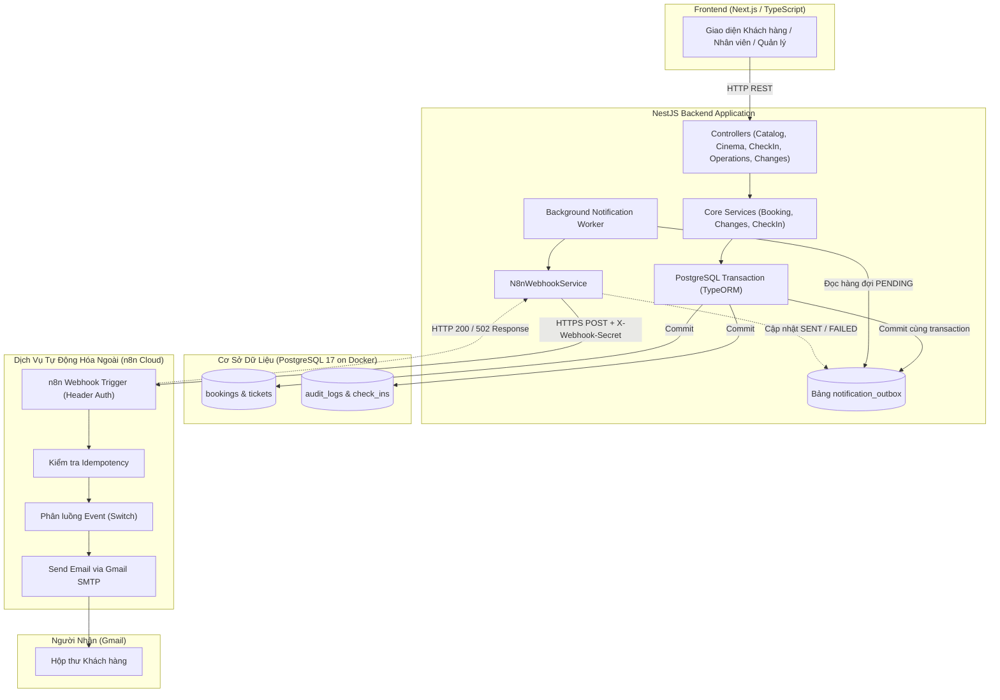

# Kiến Trúc Thông Báo & Tự Động Hóa – Starlight Cinema

Tài liệu này phân tích chi tiết thiết kế kiến trúc thông báo (Notification Architecture) cho hệ thống rạp chiếu phim Starlight Cinema, đảm bảo tính toàn vẹn dữ liệu, khả năng chịu lỗi và tính xác thực học thuật cho đề tài MIS3047 (TP3).

---

## 1. Tổng Quan Kiến Trúc (Architecture Overview)

---

## 2. Nguyên Lý Thiết Kế Transactional Outbox Pattern

Trong các hệ thống phân tán và đặt vé thời gian thực, việc gọi trực tiếp một Webhook ra dịch vụ bên ngoài (n8n Cloud / SMTP) ngay trong luồng xử lý HTTP request tiềm ẩn các rủi ro nghiêm trọng:
1. **Network Latency & Timeout**: Phản hồi của bên thứ ba chậm làm nghẽn thread pool của máy chủ và kéo dài thời gian phản hồi cho người dùng.
2. **Dual-write Problem**: Nếu thanh toán và phát hành vé thành công nhưng mạng tới n8n bị đứt, nếu rollback transaction thì khách mất vé dù đã trừ tiền; nếu không rollback thì email không được gửi và không có cơ chế tự động gửi lại.
3. **Double Spending / Duplicate Emails**: Người dùng reload hoặc bấm nhiều lần có thể kích hoạt gửi nhiều email trùng lặp.

### Giải pháp áp dụng tại Starlight Cinema:
- **Nguyên tử (Atomicity)**: Khi vé được xác nhận hoặc đổi/hoàn tiền thành công, bản ghi thông báo được ghi vào bảng `notification_outbox` trong **cùng transaction** với đơn hàng.
- **Bất đồng bộ (Asynchronous)**: Worker định kỳ quét các thông báo `PENDING` và đẩy sang n8n Cloud mà không làm chậm trải nghiệm đặt vé của khách hàng.
- **Đảm bảo At-Least-Once Delivery**: Nếu n8n Cloud gặp sự cố hoặc timeout, bản ghi vẫn giữ trạng thái `PENDING` với thời gian `next_retry_at` tăng theo hàm mũ (exponential backoff). Thất bại gửi email **tuyệt đối không làm hủy giao dịch đặt vé**.

---

## 3. Ranh Giới Trách Nhiệm Giữa Backend & n8n Cloud

| Thành phần | Trách nhiệm | Ràng buộc bảo mật |
| :--- | :--- | :--- |
| **Backend NestJS** | - Kiểm tra tính hợp lệ nghiệp vụ (ghế trống, đúng suất, đủ tiền). - Commit dữ liệu vào PostgreSQL. - Sinh `eventId` duy nhất (UUID/Hash). - Tạo payload chuẩn tiếng Việt. - Quản lý hàng đợi và retry cấp database. | - Giữ bí mật `N8N_WEBHOOK_SECRET`. - Không gửi email trước khi commit DB. - Không gửi thông tin thanh toán nhạy cảm. |
| **n8n Cloud** | - Xác thực chữ ký header HTTP. - Chống trùng lặp cấp luồng tự động hóa (Idempotency). - Soạn thảo mã HTML theo mẫu thiết kế thương hiệu Starlight. - Tương tác với giao thức Gmail SMTP để gửi thư. - Báo cáo kết quả mã hóa phản hồi HTTP 200/502 cho Backend. | - Sử dụng Header Auth Credential an toàn. - Tận dụng credential Gmail SMTP "SMTP account" có sẵn. - Tự động kích hoạt cơ chế retry khi Gmail SMTP quá tải. |

---

## 4. Đặc Tả Dữ Liệu Các Sự Kiện Nghiệp Vụ

### 4.1. `booking.confirmed`
Phát sinh khi khách hàng hoàn tất thanh toán (được xác thực độc lập từ MoMo hoặc ngân hàng), ghế được khóa chính thức và vé điện tử được cấp.
- Trường bắt buộc: `eventId`, `eventType`, `occurredAt`, `recipientEmail`, `booking.id`, `booking.total`, `movie.title`, `showtime.startsAt`, `seats`.

### 4.2. `ticket.exchange.completed`
Phát sinh khi nhân viên quầy xử lý yêu cầu đổi vé đủ điều kiện (>60 phút trước giờ chiếu, cùng rạp, cùng phim), vé cũ chuyển trạng thái `REPLACED` và vé mới được phát hành.
- Trường bắt buộc: `eventId`, `eventType`, `occurredAt`, `recipientEmail`, `exchange.requestId`, `exchange.newTickets`, `exchange.payable`.

### 4.3. `ticket.refund.completed`
Phát sinh khi quản lý phê duyệt và lệnh hoàn tiền từ nhà cung cấp/kế toán được ghi nhận thành công, vé chuyển sang trạng thái `REFUNDED`.
- Trường bắt buộc: `eventId`, `eventType`, `occurredAt`, `recipientEmail`, `refund.requestId`, `refund.amount`, `refund.reason`.

### 4.4. `ticket.checked_in`
Phát sinh khi nhân viên soát vé quét QR tại cửa vào phòng chiếu. Sự kiện được ghi nhận vào bảng kiểm toán (`audit_logs`) và chuyển sang n8n để lưu vết; **không gửi email đến khách hàng** nhằm tránh làm phiền.
- Trường bắt buộc: `eventId`, `eventType`, `occurredAt`, `checkIn.ticketId`, `checkIn.staffId`, `checkIn.checkedInAt`.

---

## 5. Đánh Giá Độ Tin Cậy & Khả Năng Mở Rộng

1. **Khả năng mở rộng**: Nhờ sử dụng cơ chế `FOR UPDATE SKIP LOCKED` trong PostgreSQL, nhiều worker có thể chạy song song mà không tranh chấp cùng một bản ghi thông báo.
2. **Khả năng quan sát (Observability)**: Mọi nỗ lực gửi thông báo đều được ghi lại số lần thử (`attempts`) và lỗi chi tiết (`last_error`), giúp kỹ sư vận hành dễ dàng tra cứu qua bảng `notification_outbox` hoặc báo cáo quản trị.
